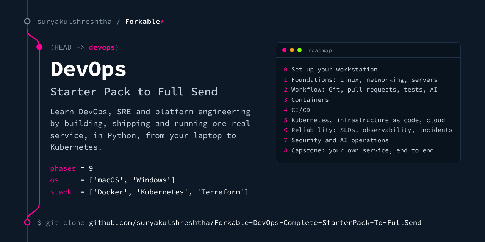
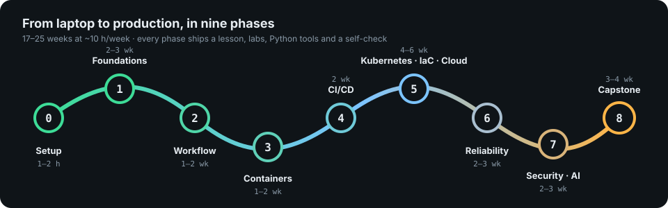
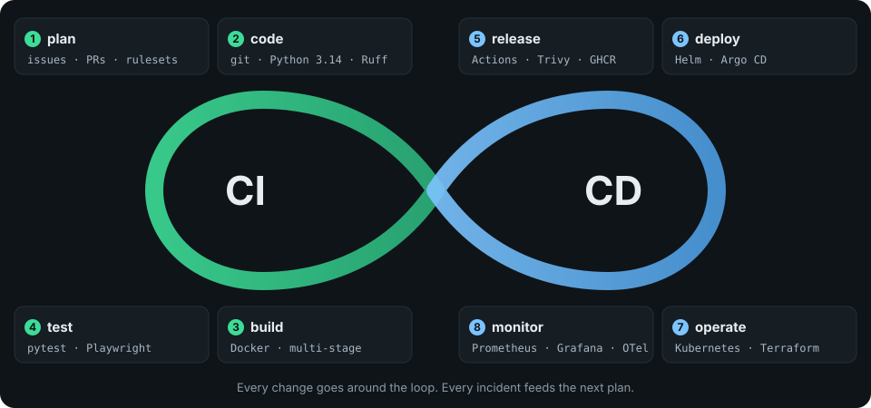
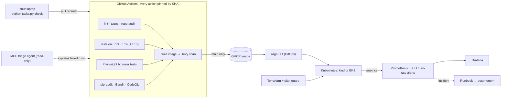

<!-- forkable-card:start (added by apply_cards.py; re-run it to update) -->

<!-- forkable-card:end -->

# Forkable DevOps: Complete StarterPack to FullSend

**Learn DevOps, SRE and platform engineering by building, shipping and running one real service, in Python, from your laptop to Kubernetes.**

[](https://github.com/suryakulshreshtha/Forkable-DevOps-Complete-StarterPack-To-FullSend/actions/workflows/ci.yml)
[](https://github.com/suryakulshreshtha/Forkable-DevOps-Complete-StarterPack-To-FullSend/actions/workflows/infra.yml)
[](LICENSE)

Fork it, follow nine phases, and finish with a portfolio that shows what 2026
hiring teams ask for: Kubernetes, Terraform, CI/CD you can defend, SLOs and incident
handling, supply-chain security, and AI tools used daily with guardrails.



| What makes it different | How |
|---|---|
| **One app through the whole loop** | You build, test, containerise, deploy, monitor, break and secure *FullSend*, a small deployment-log service that also reports DORA metrics. |
| **Python everywhere** | The app, the tests, every lab tool, the task runner and the AI agent are Python. Bash, YAML and HCL appear only where a tool requires them. |
| **Same commands on macOS and Windows** | One task runner (`python tasks.py …`). Where commands differ, each lesson shows a macOS table and a Windows table. |
| **Tested like production** | 200+ tests: unit, API, browser (Playwright), tooling, infrastructure and a self-check for every phase. CI runs them all. |
| **Checked against official sources** | Every version is pinned and was checked against its official source on 2026-10-12 ([VERSIONS.md](VERSIONS.md), [SOURCES.md](SOURCES.md)). |
| **Secure by default** | Actions pinned to commit SHAs, least-privilege tokens, non-root containers, `restricted` Pod Security, scanned images. |

---

## Roadmap

Each phase has a lesson, hands-on labs, Python tools, interview questions, an AI
exercise with guardrails, and a self-check you run with `pytest`. The phases follow
[milanm/DevOps-Roadmap](https://github.com/milanm/DevOps-Roadmap) (all twelve steps plus its
DevSecOps bonus), reordered around the delivery loop and extended with SRE practice,
AI operations and what current job postings ask for.

| # | Phase | Time* | You build | Roadmap steps |
|---|---|---|---|---|
| 0 | [Set up your workstation](phases/00-setup/README.md) | 1–2 h | Python 3.14, a virtual environment, the app running, every check green | setup |
| 1 | [Foundations: Linux, networking, servers](phases/01-foundations/README.md) | 2–3 wk | A DNS→TCP→TLS→HTTP probe, an access-log analyser, Nginx load balancing two app containers, coding-round warm-ups | 2, 3, 4, 5 |
| 2 | [Workflow: Git, pull requests, tests, AI](phases/02-workflow/README.md) | 1–2 wk | A Conventional Commits hook, a test-first feature through a PR, an honest AI log | 1, 12 |
| 3 | [Containers](phases/03-containers/README.md) | 1–2 wk | A multi-stage, non-root, health-checked image and an image auditor | 6 |
| 4 | [CI/CD](phases/04-cicd/README.md) | 2 wk | A hardened GitHub Actions pipeline publishing to GHCR, branch rulesets, a DORA baseline | 9 |
| 5 | [Kubernetes, infrastructure as code, cloud](phases/05-kubernetes-iac-cloud/README.md) | 4–6 wk | kind, Helm with a values schema, GitOps with Argo CD, EKS in Terraform, a plan guard | 7, 8, 11 |
| 6 | [Reliability: SLOs, observability, incidents](phases/06-reliability/README.md) | 2–3 wk | Prometheus, Grafana, burn-rate alerts, a runbook, an incident you cause and write up | 10 |
| 7 | [Security and AI operations](phases/07-security-ai/README.md) | 2–3 wk | A threat map, the 2026 Trivy supply-chain case study, a secret scanner, a read-only MCP triage agent | bonus |
| 8 | [Capstone: your own service, end to end](phases/08-capstone/README.md) | 3–4 wk | A public repository that proves the whole loop on a service you choose | all |

\* Our estimates at about 10 hours a week; they add up to 17–25 weeks. Take longer where you need to.

Track your progress in [PROGRESS.md](PROGRESS.md).

---

## Quick start

You need **Python 3.14** and **Git** to begin; Docker, kubectl, kind, Helm and
Terraform come later (each phase says when). Full install tables, troubleshooting
and the dev-container shortcut are in [Phase 0](phases/00-setup/README.md).

**1. Fork, then clone your fork** (same in macOS Terminal and Windows PowerShell):

| Step | Command |
|---|---|
| Clone | `git clone https://github.com/<your-github-user>/Forkable-DevOps-Complete-StarterPack-To-FullSend.git` |
| Enter | `cd Forkable-DevOps-Complete-StarterPack-To-FullSend` |

**2. Create and activate a virtual environment** (the only commands that differ):

**macOS (Terminal)**

| Step | Command |
|---|---|
| Install Python 3.14 | `brew install python@3.14` |
| Create the environment | `python3.14 -m venv .venv` |
| Activate it | `source .venv/bin/activate` |

**Windows (PowerShell)**

| Step | Command |
|---|---|
| Install Python 3.14 | `py install 3.14` (after the Python Install Manager, see Phase 0) |
| Create the environment | `py -V:3.14 -m venv .venv` |
| Allow activation scripts (once) | `Set-ExecutionPolicy -ExecutionPolicy RemoteSigned -Scope CurrentUser` |
| Activate it | `.venv\Scripts\Activate.ps1` |

**3. Everything else is identical on both systems:**

| Step | Command | You should see |
|---|---|---|
| Install the app, tools and a Chromium browser | `python tasks.py setup` | `Successfully installed …` |
| Run every check CI runs | `python tasks.py check` | `✓ all checks passed` |
| Run the browser tests | `python tasks.py e2e` | `5 passed` |
| Start the app | `python tasks.py serve` | open <http://127.0.0.1:8000> |
| See which other tools you have | `python phases/00-setup/doctor.py` | a table of tools and versions |

---

## The practice app: FullSend

A small FastAPI service that records deployments (which service, which version,
which environment, did it work) and turns them into delivery metrics. Small enough
to read in an afternoon; realistic enough to operate.

| Endpoint | What it does |
|---|---|
| `GET /` | Web page: record deployments, see change fail rate and recovery time |
| `POST /api/v1/deployments` · `GET /api/v1/deployments` | Record and list deployments (validated, size-bounded) |
| `GET` · `PATCH /api/v1/deployments/{id}` | Read one, or change its outcome after a rollback |
| `GET /api/v1/dora` | Deployment frequency, change fail rate and recovery time per environment |
| `GET /api/v1/info` | Version, commit and environment of the running build |
| `GET /healthz/live` · `GET /healthz/ready` | Liveness and readiness probes |
| `GET /metrics/` | Prometheus metrics, labelled by route template |
| `GET /docs` | Interactive API documentation |

| Built in | Why |
|---|---|
| JSON logs with request ids, Prometheus metrics, optional OpenTelemetry traces | You operate it in Phase 6 |
| `CHAOS_ERROR_RATE` and `CHAOS_LATENCY_MS` fault injection, never on probes | You cause incidents on purpose |
| Strict input validation, a Content-Security-Policy, non-root container | You secure it in Phase 7 |
| Clean shutdown on SIGTERM | Rolling updates in Kubernetes lose no requests |

Configuration is environment variables only; the full table is at the top of
[`src/fullsend/config.py`](src/fullsend/config.py).

---

## How the pieces fit





---

## Repository map

```text
.
├── src/fullsend/          the practice app (FastAPI)
├── src/ci_triage/         the MCP server for AI-assisted CI triage (Phase 7)
├── tests/                 unit · api · e2e (Playwright) · agent
├── phases/00…08/          lessons, labs, Python tools and self-checks
├── qa/                    the QA track: test pyramid, Playwright, flaky tests
├── infra/                 Kubernetes manifests · Helm chart · kind · Argo CD · Terraform (EKS)
├── observability/         Prometheus rules · Grafana dashboard · SLO · runbook · postmortem
├── ai-ops/                guardrails and client set-up for the triage agent
├── scripts/               smoke test · schema validators · repository audit
├── .github/               CI, infrastructure, CodeQL, dependency review, Dependabot
├── tasks.py               one task runner for macOS, Windows and Linux
└── Dockerfile             multi-stage, non-root, health-checked image
```

Everyday tasks (same on every OS, with the virtual environment active):

| Task | Command |
|---|---|
| List every task | `python tasks.py` |
| Lint and format check · auto-fix | `python tasks.py lint` · `python tasks.py fmt` |
| Strict type check | `python tasks.py typecheck` |
| Tests with coverage (no browser) | `python tasks.py test` |
| Browser tests, watch them run | `python tasks.py e2e --headed` |
| Dependency and code security scans | `python tasks.py audit` |
| Validate YAML, JSON and Kubernetes manifests | `python tasks.py validate` |
| Links, tool policy and attribution checks | `python tasks.py repo-audit` |
| Everything above except the browser | `python tasks.py check` |

---

## What 2026 hiring teams ask for, and where you practise it

Read from job postings by Google and NVIDIA and from 2026 hiring reports on
2026-10-12. Exact postings and quotes are in [SOURCES.md](SOURCES.md#hiring-signals).
Two employers are not "the top 50 companies": treat this as a sample, and read the
postings of the companies you are aiming for.

| Signal | Where it showed up | Where you practise it |
|---|---|---|
| Titles moving to Platform Engineer, SRE and cloud infrastructure engineer | 2026 job-board and recruiter blogs | Phases 4–6, capstone |
| Kubernetes depth: autoscaling, RBAC, network policies, operators | NVIDIA SRE and DevOps postings | Phase 5 |
| Expert Terraform: state, workspaces, modules | NVIDIA senior DevOps posting | Phase 5 |
| SLOs, monitoring, rollout safety, incident command | Google and NVIDIA SRE postings | Phase 6 |
| Real coding: data structures, Python, Go or Bash automation | Google SRE minimum qualifications; NVIDIA postings | Phases 1–2, every tool |
| Demonstrated daily use of AI tools | NVIDIA senior DevOps posting; a 2026 contract SRE posting | AI exercise in every phase, Phase 7 |
| Container security scanning; CKA, CKS, CKAD as a plus | NVIDIA postings; an AI-infrastructure DevOps posting | Phases 3, 5, 7 |
| GPU and ML workloads (an add-on, not the main track) | An AI-infrastructure DevOps posting; MLOps hiring holding steady | Phase 7, optional track |

## AI in DevOps, the way this pack treats it

| Trend (2025–2026) | What the evidence says | What you do here |
|---|---|---|
| AI use is near-universal, trust is not | DORA 2025: about 90% of technology professionals use AI at work; DORA calls AI an amplifier of a team's existing strengths and weaknesses | Keep an AI log; verify every suggestion; fundamentals first |
| Agents wired into the delivery loop | 2026 trend reports describe agents for coding, testing and review, with humans setting scope and guardrails | Agents get least-privilege tokens; writes need a human |
| MCP connects assistants to DevOps tools | GitHub and HashiCorp (Terraform) publish MCP servers, and others exist for Kubernetes and the clouds | Build a read-only MCP server for CI triage, with tests for its guardrails |
| AI SRE agents and AIOps | Vendors ship incident-triage agents (New Relic launched one in February 2026; its 25% faster-resolution figure is the vendor's own) | Ground AI in real telemetry; separate AIOps from LLM observability |
| Supply-chain attacks on CI | The March 2026 Trivy GitHub Action compromise (CVE-2026-33634) stole CI secrets from pipelines that used mutable tags | Pin every action to a commit SHA; least-privilege tokens; rotate on doubt |

Sources for every row are in [SOURCES.md](SOURCES.md#ai-in-devops).

## Languages

| Language | Role here | Why |
|---|---|---|
| **Python** | Main language: app, tests, tools, agent | Stack Overflow's 2025 survey: 57.9% of developers used it; DevOpsCube's language guide names Python and Go as the best choices for DevOps |
| **Bash** (and PowerShell on Windows) | Glue in pipelines and containers | 48.7% of developers in the same survey used Bash/Shell |
| **YAML, HCL** | Kubernetes, CI and Terraform configuration | Not programming languages, but daily work |
| **Go** | Read it; write it later | Kubernetes, Helm, Terraform and Prometheus are written in Go; some postings ask for Python *or* Go |

---

## Tool policy

Every tool in this pack comes from an official project, a foundation (CNCF, Linux
Foundation, PSF) or a major vendor, and is pinned to an exact version that was
checked against its official source. Tools from small one-person projects, and tools
whose origin is excluded by this project's policy, are not used; the repository audit
enforces it on every push. The full list, with each tool's steward and licence, is in
[TOOLS.md](TOOLS.md).

## Honest status

What was run and passed before release, and what only runs on your machine or on
GitHub (Docker builds, kind clusters, the EKS lab), is listed in
[VERIFICATION.md](VERIFICATION.md). Read it before you trust a lab.

## Related learning repositories

Linked, not copied (their licences differ from this one):

| Repository | Use it for |
|---|---|
| [milanm/DevOps-Roadmap](https://github.com/milanm/DevOps-Roadmap) | The roadmap these phases map to, with curated free resources |
| [MichaelCade/90DaysOfDevOps](https://github.com/MichaelCade/90DaysOfDevOps) | A day-by-day companion read |
| [bregman-arie/devops-exercises](https://github.com/bregman-arie/devops-exercises) | Interview practice across many topics |
| [bregman-arie/system-design-notebook](https://github.com/bregman-arie/system-design-notebook) | System-design exercises with diagrams |

## Contributing, security, licence

- Improvements are welcome: read [CONTRIBUTING.md](CONTRIBUTING.md).
- Found a vulnerability? See [SECURITY.md](SECURITY.md); please do not open a public issue.
- Licensed under the [Apache License 2.0](LICENSE); see [NOTICE](NOTICE). Third-party
  tools you install while following the lessons keep their own licences.
